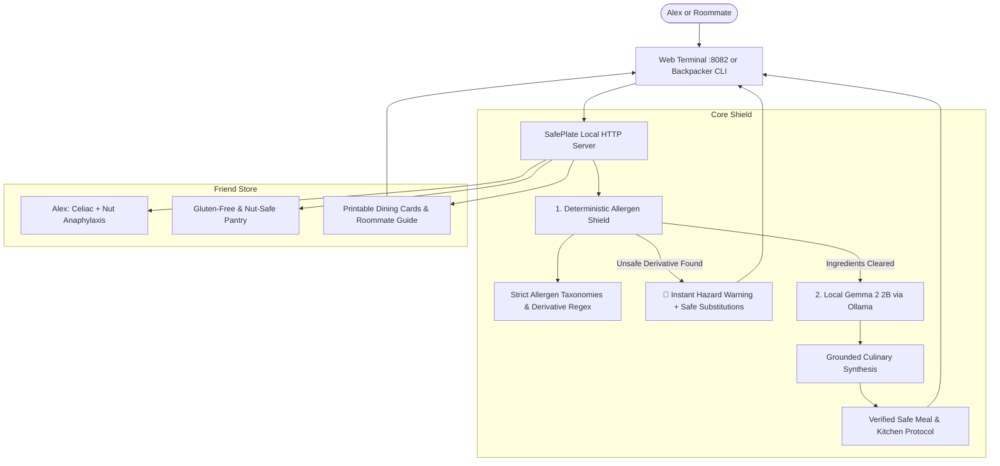

*This is a submission for the [Hacktoberfest Weekend Challenge: Build for a Friend](https://dev.to/devteam/join-the-hacktoberfest-weekend-challenge-build-for-a-friend-2450-in-prizes-across-17-winners-1aj5). Targeted Partner Category: **Best Use of Gemma ($200)**.*

---

## 🍽️ The Friend I Built This For

Every weekend dinner in our apartment used to start with a miniature interrogation.

My close friend and roommate, **Alex**, lives with two deeply unforgiving medical realities: **severe Celiac Disease** and **life-threatening Anaphylaxis to Tree Nuts and Peanuts**. For Alex, food isn't just sustenance—an accidental bite containing trace gluten means weeks of debilitating gut inflammation, while a stray cashew, almond, or peanut oil droplet triggers an immediate rush to the emergency room with an EpiPen.

When Alex and I moved in together, we quickly realized that living with severe allergies extends far beyond just checking restaurant menus:
1. **Hidden Derivative Hazards:** A casual shopper checks for "wheat" or "peanuts", but miss triggers like *spelt, semolina, triticale, farro, hydrolyzed wheat protein, marzipan, praline, or maltodextrin*.
2. **Roommate Kitchen Cross-Contamination:** Sharing a kitchen means navigating shared toasters, wooden spoons that harbor gluten oils, and sponges that spread crumbs across clean plates.
3. **Dining Out Anxiety:** Explaining dual-severe allergies to busy restaurant servers often leads to confusion or blank stares.

When Alex tried asking general-purpose cloud AI chatbots for meal plans, the suggestions were outright dangerous: recommending "tamari" without verifying wheat-free certification, suggesting "nutritional yeast pesto" that secretly blended pine nuts, or casually proposing store-bought broth. **In dietary health, a 5% LLM hallucination rate is an unacceptable safety risk.**

I built **SafePlate AI** to give Alex—and anyone living with friends or family with dietary hazards—a trusted, zero-hallucination shield, offline companion, and safe meal generator.

---

## 🛡️ What SafePlate AI Does

SafePlate AI is an offline-first, zero-data-leakage safe meal planner and kitchen shield built with a strict **two-tier defense architecture**:

1. **Deterministic Allergen Screening Shield:**
   Before any text is sent to an AI, the input runs through a hardcoded regex scanner covering verified allergen taxonomies, plural forms, and derivatives. If an unsafe item is detected, SafePlate halts execution immediately, flags the exact danger words, and suggests verified safe culinary alternatives.
2. **Local Google Gemma 2 2B Intelligence (via Ollama):**
   When ingredients pass deterministic verification, Google's lightweight open-weight **Gemma 2 2B** synthesizes balanced, chef-grade recipes, cross-contamination prevention steps, and pantry-friendly substitutions—running 100% locally on a laptop.
3. **Roommate Kitchen Guard & Protocols:**
   Generates actionable apartment protocols: color-coded cutting boards, separate toaster racks, air-fryer foil shields, and cleaning procedures to keep shared spaces safe.
4. **Server Dining & Travel Cards:**
   Generates exportable, print-ready allergy explanation cards designed to hand directly to kitchen staff and servers at restaurants.
5. **Dual Interface (Web Dashboard + Backpacker CLI):**
   Includes a warm, sourdough/sage kitchen terminal web UI (`http://localhost:8082`) and a standalone interactive terminal CLI (`safeplate_cli.py`) for grocery store aisles, camp kitchens, and spotty cellular zones.

---

## 💻 Code Repository



The entire codebase is open source under the MIT License with zero required third-party Python dependencies (built on Python's robust standard library).

---

## 🧠 Why Open Innovation Matters for SafePlate AI

Why did building SafePlate AI require open-source AI and open weights, rather than calling a proprietary cloud LLM API?

### 1. Zero Health Data Leakage (Absolute Privacy)
Dietary allergies and autoimmune disorders like Celiac Disease are sensitive personal medical conditions. Alex should never have to submit daily food logs, symptom histories, or health profiles to corporate cloud servers where data is mined for targeted insurance ads or ad broker tracking. With **Gemma 2 2B running locally via Ollama**, zero bytes ever leave the device.

### 2. Zero-Hallucination Determinism Grounding
Closed APIs treat allergy validation as a fuzzy, probabilistic chat prompt. Open innovation allowed us to pair an open-weight model with a strict deterministic Python verification layer. We control the system prompts, enforce precise temperature ceilings (0.2), and inspect the raw token generations without proprietary safety filters silently refusing or truncating medical dietary context.

### 3. Works in Grocery Basements and Remote Campsites
Allergy emergencies don't happen in air-conditioned offices with gigabit fiber. Alex and I frequently camp and hike in rural spots with zero cell reception. SafePlate AI runs locally on an offline laptop or low-power mini PC in a kitchen or camper van. Even if Ollama is paused, the deterministic engine seamlessly falls back to local safe meal catalogs.

### 4. Zero Operational Cost
For a young adult managing expensive gluten-free groceries and medical copays, recurring API subscriptions are an unfair tax. SafePlate AI costs \$0.00 to run forever.

---

## 🏗️ Architecture & How It Works



### The Deterministic Pre-Screening Engine (`backend/allergy_engine.py`)

```python
def scan_ingredients_deterministic(ingredients_text, profile):
    allergies = profile.get("allergens", [])
    detected_hazards = []
    
    for allergen in allergies:
        triggers = TAXONOMY.get(allergen.lower(), {}).get("triggers", [])
        for trig in triggers:
            pattern = r'\b' + re.escape(trig) + r'(?:s|es)?\b'
            if re.search(pattern, ingredients_text, re.IGNORECASE):
                detected_hazards.append({
                    "allergen": allergen,
                    "matched_trigger": trig,
                    "substitutions": TAXONOMY.get(allergen.lower(), {}).get("substitutions", [])
                })
    return detected_hazards
```

### Grounding Local Gemma 2 2B

When ingredients pass the shield, SafePlate constructs a strict prompt with explicit negative constraints:

```python
prompt = f"""You are SafePlate AI, a certified allergen safety and culinary expert.
TARGET PROFILE: {profile['name']}
STRICT MEDICAL ALLERGENS TO EXCLUDE: {', '.join(profile['allergens'])}

INGREDIENTS AVAILABLE:
{', '.join(ingredients)}

RULES:
1. NEVER include or suggest any ingredient derived from {', '.join(profile['allergens'])}.
2. Provide explicit cross-contamination cooking tips for roommates.
3. Suggest safe seasoning alternatives.

Generate a safe, delicious, step-by-step recipe.
"""
```

---

## 🛠️ Built With

- **Google Gemma 2 2B (`gemma2:2b`)**: Open-weight LLM for grounded recipe synthesis and intelligent culinary substitutions.
- **Ollama**: Local model runtime with streaming HTTP API.
- **Python 3.10+ Standard Library**: `http.server`, `urllib.request`, `json`, `re`, `unittest` — zero bloated external packages.
- **Modern Kitchen Terminal UI**: Vanilla HTML5, CSS3 (warm sourdough cream, sage forest, saffron gold palette), and ES6 JavaScript.
- **SafePlate CLI**: Terminal CLI with ANSI color coding for quick kitchen lookups.
- **Automated Test Suite**: 8 unit tests validating deterministic regex matching, plural forms, profile loading, and fallback mechanisms.

---

## 🤖 Agent Session Transcript

Here is the full recorded transcript of how SafePlate AI was architected, tested, and pushed:



---

## 🌟 What This Means for Alex

Last night, we fired up SafePlate AI in our kitchen. Alex punched in random staples we had in the fridge: quinoa, chicken breast, spinach, garlic, and tamari. SafePlate verified the certified gluten-free status of the tamari, warned against using the wooden cutting board used for regular sandwich bread earlier that afternoon, and Gemma 2 generated a delicious garlic-ginger citrus glazed skillet bowl.

For the first time in months, Alex didn't have to spend 20 minutes scouring the internet wondering if dinner was going to trigger an autoimmune flare-up or an allergic reaction. 

Building open-source AI for someone you care about proves that technology doesn't have to live in massive cloud silos to make a life-changing difference. With tools like Gemma 2 running privately in our homes, open AI belongs to everyone.
