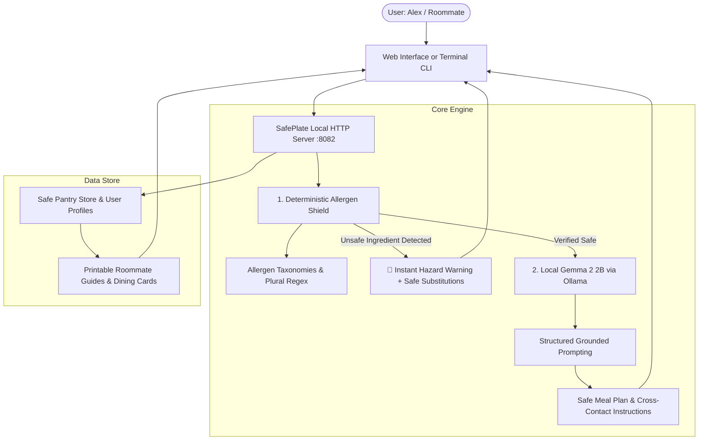

# 🛡️ SafePlate AI: Zero-Hallucination Safe Meal Planner & Allergy Shield

[](LICENSE)
[](https://hacktoberfest.com)
[-blue.svg)](https://ollama.com/library/gemma2)
[](https://python.org)

> **Built for a Friend:** Built for my friend and roommate, **Alex**, who manages severe **Celiac Disease (Gluten)** and life-threatening **Tree Nut & Peanut Anaphylaxis**. Cooking in a shared kitchen or grocery shopping with invisible allergens shouldn't require risking an ER visit.

---

## 📖 The Problem & Story

When my roommate Alex was diagnosed with adult-onset Celiac Disease alongside existing anaphylactic tree nut and peanut allergies, dinner went from a casual communal activity to high-stakes anxiety. 

Generic AI chatbots and meal planners are notorious for dangerous dietary hallucinations:
- Recommending standard soy sauce or barley malt syrup for a celiac.
- Suggesting pesto or mole sauce without recognizing hidden almond, pine nut, or walnut cross-reactivity.
- Failing to account for shared toaster crumbs or cast-iron seasoning in a roommate flat.

Medical dietary requirements cannot tolerate a 5% hallucination rate. Furthermore, personal health conditions and dietary limitations shouldn't be packaged and sold to third-party ad brokers in the cloud.

**SafePlate AI** solves this with a **two-tier defense architecture**:
1. **Deterministic Pre-screening Shield:** Hard-coded allergen taxonomies (with regex word boundaries and derivative ingredient detection) reject unsafe inputs *before* any prompt reaches the language model.
2. **Local Open-Source Gemma 2 2B:** Powered by Google's Gemma 2 running locally via Ollama with strict temperature constraints, zero data egress, and custom grounding rules.
3. **Roommate Protocol & Safe Dining Cards:** Generates printable kitchen protocols (shared sponge/toaster warnings) and multi-lingual restaurant cards for travel.

---

## 🌟 Key Features

- ⚡ **Deterministic Ingredient Screening:** Scans recipes, restaurant menus, and ingredient lists for hidden derivatives (e.g., maltodextrin from wheat, spelt, semolina, lupin, hydrolyzed wheat protein, marzipan, praline).
- 🧠 **Local Gemma 2 2B Intelligence:** Runs 100% locally via Ollama with 0 tokens transmitted to cloud servers. Safe meal synthesis and smart substitution recommendations.
- 👥 **Multi-Friend Profile Switching:** Pre-configured for **Alex** (Celiac + Nut-Free) and **Maya** (Dairy + Shellfish Intolerant), with support for custom profiles.
- 🥪 **Shared Kitchen Cross-Contamination Guard:** Concrete protocols for roommates (e.g., dedicated cutting boards, banishing wooden spoons, toaster liners).
- 🏷️ **Server Dining & Travel Cards:** Instant pocket cards clearly communicating anaphylactic risks and cross-contact avoidance in plain language.
- 💻 **Dual Interfaces:**
  - Modern, responsive Web Terminal (`http://localhost:8082`) styled in warm sourdough and sage earth tones.
  - Offline-first Terminal CLI (`python cli/safeplate_cli.py`) for backpackers, camp kitchens, and grocery aisles.
- 📦 **Zero-Dependency Core:** Built using Python's standard library (`http.server`, `urllib.request`, `json`, `re`, `unittest`) so it runs anywhere without complex build chains.

---

## 🏗️ Architecture



---

## 🚀 Quick Start

### Prerequisites
1. **Python 3.10+** (uses standard library).
2. **Ollama** (optional but recommended for LLM synthesis):
   ```bash
   # Install Ollama and pull Gemma 2 2B
   ollama run gemma2:2b
   ```
   *Note: If Ollama is not running, SafePlate AI seamlessly falls back to its deterministic recipe catalog and offline substitution engine.*

### Running the Web Dashboard
```bash
# Clone the repository
git clone https://github.com/shashiharanramvanam-crypto/safeplate-ai.git
cd safeplate-ai

# Start the web server
python backend/app.py 8082
# Or on Windows, double-click:
run.bat
```
Open [http://localhost:8082](http://localhost:8082) in your browser.

### Running the Terminal CLI
```bash
python cli/safeplate_cli.py
# Or on Windows:
run_cli.bat
```

### Running the Automated Tests
```bash
python tests/test_suite.py
```
*Expected: 8/8 tests passing.*

---

## 🏆 Hacktoberfest 2026

- **Challenge:** [Hacktoberfest Weekend Challenge: Build for a Friend](https://dev.to/devteam/join-the-hacktoberfest-weekend-challenge-build-for-a-friend-2450-in-prizes-across-17-winners-1aj5)
- **Target Category:** **Best Use of Gemma ($200)** — Uses Google Gemma 2 2B for local offline inference, ensuring zero medical data leaks.
- **Tags:** `#devchallenge`, `#weekendchallenge`, `#hf26challenge`, `#gemma`

---

## 📄 License

This project is licensed under the MIT License - see the [LICENSE](LICENSE) file for details.
